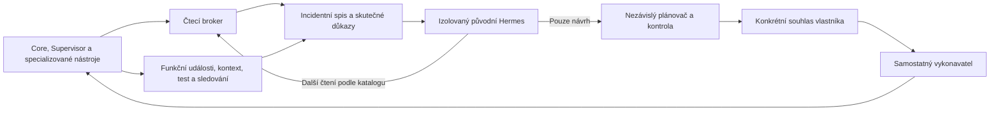

# Souhrnná kontrola orchestrace po RC7

Změny jsou v jednom [PR #19](https://github.com/OndraMa/HADS/pull/19), nad RC7
`c1372a392f213ab995c9848ae9721b3732967268`. Jde o zdrojovou vývojovou větev,
nikoli nové vydání. Dosavadní instalátor a vydané archivy RC7 zůstávají stejné.
Úplné původní zadání zatím není splněné; samotné úspěšné CI tento závěr nemění.

Přesné revize, výsledky a otisky protokolů jsou v
[RESULTS.json](evidence/orchestration/RESULTS.json). Matice původních požadavků i aktuální
architektonické korekce je v [orchestration-matrix.json](orchestration-matrix.json).

Revize `b34f68bcef944e48f71fd0858ace17deb4ce8952` prošla **304 testy lokálně i na každé
architektuře ARM64/AMD64** a 22 mobilními/desktopovými pohledy. Oba nativní kontejnerové
průchody v [běhu 44156311112](https://github.com/OndraMa/HADS/actions/runs/44156311112)
skončily úspěšně. Protokoly jsou zachované přímo v této větvi, nikoli jen v dočasných
artefaktech Actions. Následný dokumentační commit nemění žádný z 158 ověřených vstupních souborů.

## Co je skutečně zapojené

Stávající aplikace používá společný registr providerů a funkcí, autonomní čtecí broker,
incidentní databázi, původní izolovaný Hermes a samostatný schvalovaný vykonavatel.
Konkrétní reporty nejsou nahrazené kontrolou procesu nebo čtením libovolné entity.

- **Inspector a HADocs:** skutečné strukturované HTTP reporty. Inspectorovy závislosti
  rozšíří dotčené automatizace ve spisu. HADocs může mít po restartu procesů existující
  report bez doloženého času; HADS ho přečte s výslovně neověřenou čerstvostí.
- **HA-MCP:** autentizace, stránkovaný katalog, režim tool-search, skutečná schémata,
  omezená čtení stavu/zařízení/konfigurace/health. Obecné proxy nepřebírají autoritu modelu.
- **Spook:** skutečný společný Repairs výsledek, katalog služeb a oddělený opravný adaptér.
  HADS nevydává všechny Repairs za výhradní nálezy Spooku.
- **Nativní MCP a Hamster:** konkrétní ověřené čtecí podmnožiny. Nepodporované nebo
  obecné zapisovací funkce se nezpřístupní jen proto, že je server vyjmenuje.
- **Watchman, Entity Availability a HAGHS:** vlastní reporty a strukturované atributy
  včetně skutečných časů zdroje. Znovunačtení senzoru se neoznačí za nový scan.
- **ZHA a Toolkit:** dosavadní cílené registry/historie/journal a cache zařízení;
  navíc omezené čtení konkrétních standardních atributů bez zápisu a exportu.
- **Music Assistant:** původní cílený FastMCP adaptér v témže registru; nemění přehrávání.
- **Core/Supervisor/HAOS:** stávající nativní adaptéry, doplněná Recorder metadata/historie
  a dostupné nativní logy. Časové souvislosti DNS tvoří hypotézu společné příčiny.

Podrobný kontrakt každého z 15 providerů, přesné upstream revize a fallback jsou v
[přejímce](ORCHESTRATION_ACCEPTANCE_CS.md). Návod k jednorázovému připojení HA-MCP,
Hermesu a dalších zdrojů je v [nastavení](ORCHESTRATION_SETUP_CS.md).

## Jaké skutečné opravy jsou implementované

1. HA-MCP: změna jediné reference v jednoduché přímé světelné automatizaci.
   Stejnou identitu zařízení před a po přejmenování musí HADS skutečně pozorovat.
   Podobnost názvu nestačí. Žádné šablony, Python, další akce ani spuštění akcí při ukládání.
2. Spook: opětovné povolení jedné uživatelem zakázané entity, pokud vlastník výslovně
   potvrdí tento záměr. Zakázání se nepovažuje za automaticky zjištěnou závadu Zigbee.
3. Pro obě operace: nový zvlášť schvalovaný inverzní plán, přesný původní stav,
   kontrola cizích změn a ověření zpětným čtením. Návrat nevrací fyzické účinky.
   Zakázání entity se nesmí použít jako oprava hlášení; slouží pouze jako inverze povolení.

Každý plán váže providera, jeho verzi a původ, nástroj, schéma, cíl, parametry, původní stav,
důkazy, zálohu, riziko, funkční test a návrat. Schválení vlastníka má expiraci a platí pouze
pro uložený neměnný plán. Změnu cíle nebo schématu nelze schovat do opakovaného volání.

**Produkční připravenost těchto rizikových operací je blokovaná, dokud není připojen skutečný
nezávislý důkaz obnovitelnosti OneDrive.** Implementace ověřuje podepsaný kontrakt;
testovací podpis z fixtures není živá obnovitelná záloha a nesmí se přenést jako důvěra.

## Nálezy kontrolního průchodu a provedené opravy

| Nález | Provedená oprava | Konkrétní důkaz |
|---|---|---|
| Nové role překračovaly limit launcheru 32 nástrojů | Čtyři společné vstupy; dvě duplicitní přímé zkratky zůstaly dostupné brokerem | Původní izolovaný Hermes v nativním CI, nezměněný limit |
| Tool-search může vrátit obal FastMCP místo přímého seznamu | Ověřené rozbalení `_meta.fastmcp.wrap_result`, pevné read/write proxy | MCP SDK a HTTP kontraktní testy |
| Prázdný Bearer mohl odmítnout privátní endpoint | Bez tokenu se Authorization neposílá | Skutečný lokální JSON-RPC přenos bez Beareru |
| HA-MCP může vyžadovat přísný best-practices receipt | Čtení skutečného průvodce a vazba jeho obsahu/klíče na plán | Změna receipt zablokuje zápis; ochrany se nevypínají |
| Přejmenované ID mohl převzít jiný fyzický cíl | Vazba stabilní identity v přípravě, preflight i ověření | Negativní scénář opětovného použití ID |
| Rollback mohl nasměrovat staré ID na nového držitele | Původně chybějící reference musí stále vracet skutečné 404 | Provedení inverze po novém souhlasu; zákaz po obsazení ID |
| Nejistý zásah mohl obejít jiný spis/provider | Nevyřešená nejistota blokuje další zápisy tohoto brokeru | Druhý spis a jiný provider neprovedou zápis |
| Nejistý zápis neměl provozní zotavení | Omezené automatické kontrolní čtení; vlastník může přijmout pozorovaný stav k novému funkčnímu testu | Ztracená odpověď, restart, žádný replay ani skrytý rollback |
| Po vyčerpání automatických kontrol nešlo obnovit čtení po ruční nápravě | Vlastník může nejvýše jednou za minutu vyžádat nový readback a poté přijmout ověřený stav | Vyčerpaný automatický rozpočet, cizí identita i příliš časný požadavek; žádný další providerový zápis |
| Chybělo automatické spuštění ověřovacího odběru nového katalogu | Spuštění po zápisu i obnovení rozpracovaného ověření po restartu | Skutečné zavolání event transportu bez aktivace companion katalogu |
| Nový katalog nepropagoval potvrzené opakování závady | Trvalý report a znovuotevření spisu z funkčního monitoru | Ověřeno → nová funkční porucha → otevřený spis, původní souhlas se neopakuje |
| Událost mohla být v rozporu s aktuálním stavem Core | Nové čtení musí souhlasit; protichůdné nebo chybějící čtení přeruší sledovací interval | Starý trigger a potvrzení neuzavřou případ; vyžaduje se nový funkční průchod a pokrytí |
| Sdílený HTTP stav mohl patřit jinému čtení | Bezpečnostně rozhodující čtení vykonavatele mají vlastní CoreReader a ověřený cíl odpovědi | Cizí 404 nepřemění chybu oprávnění na důkaz chybějící reference; absence se znovu ověří i před zápisem |
| Nejistý zásah a inverzní plán nebyly správně vidět mezi rozhodnutími | Čekající rozhodnutí rozlišují opravu, návrat, nejistotu a funkční test | Dashboard při nejistotě skutečně ukazuje příslušný spis; zamítnuté a zastaralé plány vyřešeného spisu se nepočítají jako připravené |
| Staré ověření mohlo přežít nový schválený zásah do stejného spisu | Nový trvalý intent zneplatní dřívější uzavření atomicky, bez nového funkčního výskytu | Ověřeno → schválený rollback → otevřený spis, stejný počet skutečných výskytů |
| Původní inventář ignoroval výsledek nového konektoru | Stav konkrétního reportu a katalogu se promítá i do existujícího přehledu | Provozní check_sources přečte report a inventář už netvrdí, že přečtený zdroj nebyl ověřen |
| Obnovení stejného MCP katalogu mazalo příznak již ověřeného čtení | Skutečný čas čtení se zachová pouze pro stejný původ, verzi, identitu a schéma; obnova katalogu jej neposouvá | Nezměněný katalog zachová timestamp, změna schématu zneplatní ověření |
| Poškozené konektory mohly zastavit aplikaci | Neověřené připojení se neaktivuje; incidenty a nativní diagnostika pokračují | Neplatný JSON a neplatné typy souboru konfigurace |
| Čekání na uživatele tvořilo opakované stejné záznamy | Deduplikované plány/reporty, omezený žurnál a ověřovací dávky; bez nového funkčního testu se nepřidávají prázdné checkpointy | Celá regresní sada, funkční a negativní scénáře |

Jde o druhý kontrolní průchod autora a ověření oddělenými testovacími kontrakty.
**Nebyl proveden audit jinou osobou ani nezávislá bezpečnostní certifikace.**
Požadovaná nezávislá provozní přejímka tím není nahrazená.

## Co protokoly skutečně dokazují

- `offline`: anonymizované fixtures, skutečné lokální HTTP/MCP přenosy a SDK,
  schválení → jeden testovací zápis → readback → funkční pozorování → český report.
  Testovací vlastnické potvrzení a hodiny nepředstavují fyzickou odezvu domácnosti.
- `container`: ARM64 a AMD64, skutečný Core 2026.11.0, původní pinned Hermes,
  skutečný upstream Inspector builder proti Core WS. Hermes vybere Inspector ze společného
  katalogu, přečte jeho report a naváže konfigurací/trace/stavem Core a předáním role.
  Model je lokální skriptovaný endpoint s nejvýše osmi požadavky; placená volání jsou nulová.
- `approved_wire_e2e`: samostatný společný průchod původního izolovaného Hermesu přes report,
  schéma a HA-MCP návrh; agent provede nula zápisů. Teprve simulovaný přihlášený vlastník přes skutečnou
  HTTP/CSRF hranici schválí jeden zápis do kontraktního poskytovatele a poté proběhne funkční ověření.
  Core/provider v tomto dodatečném scénáři jsou doubles, pozorování jsou vstříknutá a hodiny řízené;
  původní Hermes i kontroler jsou skutečné. Oddělený výše popsaný test používá skutečný Core/Inspector.
- `offline_browser`: 22 mobilních/desktopových pohledů, přihlašovací ingress fixture,
  maskované privátní nastavení konektorů a oddělený souhlas s náklady.
- `live`: **čeká**. Není ověřena instalace této větve na HAOS, fyzický Zigbee senzor,
  rádio, runtime nainstalovaného HA-MCP/Spook/HADocs ani úsudek reálného modelu.

Kontejnerový Inspector test používá jeho skutečný builder; jeho aplikační HTTP listener
se v tomto testu nespouští. HTTP kontrakt má oddělený wire test.
Skriptovaný endpoint není náhradou kvality skutečného modelu. ARM64 CI není měření na RPi 4/2 GB.

## Přesné zbývající hranice

Nejbližší provozní přejímka musí potvrdit autentizované odpovědi skutečně nainstalovaných
providerů, dostupnost interních adres aplikací, reálné zdrojové časy a funkční dopad u konkrétního případu.
HADS má diagnostiku provádět sám; vlastník poskytuje jen jednorázové připojení, nezbytné rozhodnutí,
konkrétní schválení a případný fyzický funkční test. Není potřeba ručně kopírovat terminálové diagnostiky.

Znovuotevření používá funkční monitor téhož spisu a jeho definovanou nesplněnou podmínku.
Ručně nahlášenému případu bez monitorovací podmínky se tím neslibuje neomezené sledování.
Očekávané chování musí být doložené nebo potvrzené vlastníkem; běžné zhasnutí světla není automaticky opakování závady.

Zůstává také **implementační omezení katalogu**: obecné změny statistik, registrů, dashboardů,
skriptů a Zigbee binding/reporting/kanálu nejsou podporované automatické opravy.
Jejich pouhé přeposlání do služby není bezpečná implementace: chybí pro ně konkrétní
ověřená transformace, nezávislá obnovitelnost a dostatečný funkční/inverzní kontrakt.
Zůstávají blokované s konkrétním ručním postupem nebo dalším čtením. Tento nedodělek
není označený jako pouhá absence přístupu k domácnosti.

Nové vydání se nepřipravuje, dokud není zkontrolovaná celá matice a odstraněné bezpečně
řešitelné mezery. [Přesný živý postup](ORCHESTRATION_LIVE_ACCEPTANCE_CS.md)
odděluje čtení, malý výslovný modelový test, skutečný důkaz obnovy, jediné schválení opravy,
funkční výsledek, případný zvláštní rollback a sledování opakování.
